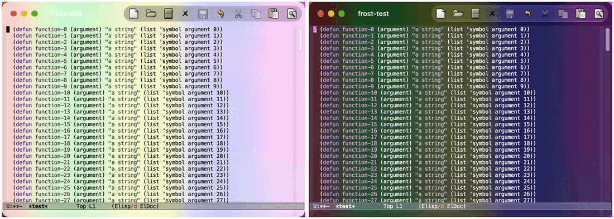

# frost

Frosted-glass Emacs frames on macOS: the frame is see-through, with what is behind it blurred,
and its text keeps its colours. It follows the theme, dark or light.



## What it needs

- macOS, and GNU Emacs built with the NS (Cocoa) port and with modules
  (`module-file-suffix` is non-nil);
- the Command Line Tools (`xcode-select --install`), for `clang`.

The first time `frost-mode` is turned on, it builds its native module, `frost.m`, into
`frost-module.dylib` in the package's own folder, and builds it again when `frost.m` is newer.
A rebuilt module takes effect at the next start of Emacs. If the build or the load fails, it
says so in a message and Emacs carries on as usual. Elsewhere (another OS, another port, a
terminal frame) the mode does nothing.

Run on GNU Emacs 31.1 (the NS port, as the `emacs-plus` cask builds it) on macOS 27.2. The code
reads the view layout of Emacs 30 and 31; older versions were not run.

## Installing

```elisp
(use-package frost
  :vc (:url "https://github.com/xiaoxinghu/frost" :rev :newest)
  :hook (after-init . frost-mode))
```

Or from a copy of this folder:

```elisp
(add-to-list 'load-path "/path/to/frost")
(require 'frost)
(frost-mode 1)
```

The mode can be turned on before any graphical frame exists (a daemon): frames made later,
with `emacsclient -c` or `C-x 5 2`, are frosted as they are made.

## Options

- `frost-tint-opacity`, 65: how much of the theme's background lies over the glass, 0 to 100.
  Lower lets more of the backdrop through; too low and a bright window behind washes a dark
  theme out.
- `frost-tint-color`, nil: the tint's colour; nil is the default face's background.
- `frost-material`, `hud-window`: the system material behind the frame, by its
  `NSVisualEffectView` name. Most of the others are close to opaque.

## How it works

For each top-level frame the module puts an `NSVisualEffectView` behind the frame's view, the
size of the whole window (so the title bar, with `ns-transparent-titlebar`, is frosted too),
then a flat tint in the theme's background colour, and sets a blend mode on the Emacs view's
layer: screen for a dark theme, multiply for a light one. The dark (or light) background then
lets the glass through and text keeps its colours. The window itself is left opaque, as Emacs
keeps it, so nothing Emacs does to the window undoes it. The views follow the window by
themselves: moving, resizing and changing displays need nothing from Emacs.

It uses no private API. It does name the blend modes by strings (`screenBlendMode`,
`multiplyBlendMode`), which Core Animation accepts and Apple does not document.

## What it cannot do

- Everything the Emacs view draws is blended: a dark image or PDF in a buffer goes
  see-through, and faces with a background of their own (region, hl-line, the mode line)
  become washes over the glass.
- Child frames (posframe, corfu) stay opaque, and so do native views other packages put in a
  frame (web views, terminals): they draw their own backgrounds.
- In native fullscreen there is nothing behind the window to blur; the frame shows the
  material's own plain colour under the tint. Non-native fullscreen moves the frame to a
  window of its own, which is not frosted until it leaves fullscreen.
- Undecorated top-level frames are not frosted.
- "Reduce transparency" is left to the system: Apple says materials follow it. Not tried here.

## Licence

GPL-3.0-or-later; see `LICENSE`. `emacs-module.h` is Emacs's own, from Emacs 29.1.
